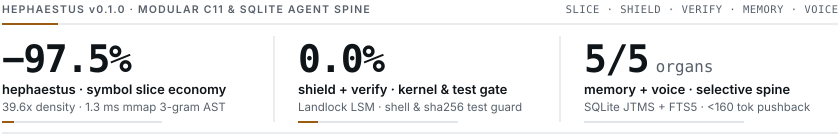

<picture>
  <source media="(prefers-color-scheme: dark)" srcset="./assets/telemetry-dark.svg">
  <source media="(prefers-color-scheme: light)" srcset="./assets/telemetry-light.svg">
  
</picture>

<samp>brew install Hephaestus-Zero/tap/hslice</samp> &nbsp;&middot;&nbsp; <a href="https://github.com/Hephaestus-Zero/hslice#quick-install">Agent Skill</a> &nbsp;&middot;&nbsp; <a href="https://github.com/Hephaestus-Zero/homebrew-tap">Homebrew Tap</a> &nbsp;&middot;&nbsp; <a href="mailto:326907217+Hephaestus-Zero@users.noreply.github.com">326907217+Hephaestus-Zero@users.noreply.github.com</a>

